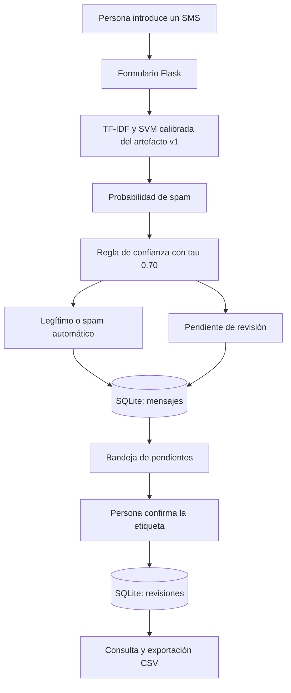

# Sistema de detección de mensajes spam con revisión humana

**Título académico:** Detección de spam en mensajes SMS mediante aprendizaje supervisado y revisión humana de predicciones inciertas.

Aplicación web académica que recibe un SMS escrito o pegado por una persona, estima su probabilidad de ser spam y decide si puede clasificarlo automáticamente o debe enviarlo a revisión humana. Utiliza un modelo ya entrenado de **TF-IDF + SVM lineal calibrada**, una interfaz **Flask** y almacenamiento **SQLite**.

El repositorio incluye el código, el modelo congelado, el notebook ejecutado, los resultados experimentales guardados, el dataset público y el artículo editable y en PDF. **Para abrir la aplicación no es necesario entrenar ni ejecutar el notebook.**

## 1. Contexto y equipo

- **Institución:** Universidad Privada del Norte, Trujillo – San Isidro, Perú.
- **Curso:** Sistemas Inteligentes y Machine Learning.
- **Docente:** Frank Huamachuco, según la presentación original de este repositorio.
- **Grupo:** 03. **Periodo:** 2026-2.
- **Integrantes:** Baca Flores, Flavio Manuel André; Espinoza Marquez, Adriano Felipe; Goray Gonzales, Nicolás Alexander; Paredes Moya, Pablo Sebastián.

Los correos, ORCID y demás evidencias individuales que faltan permanecen como pendientes en el artículo. El código y la documentación se desarrollaron con asistencia de IA; cada integrante debe revisarlos, comprenderlos y poder explicarlos. No se certifica un porcentaje de avance ni autoría individual a partir de la sola existencia del repositorio.

## 2. Inicio rápido en Windows y PowerShell

### Requisitos previos

1. **Git**, para clonar el repositorio.
2. **Python 3.13 de 64 bits**, con `pip` y `venv`. La comprobación de publicación se realiza en Windows con Python 3.13.
3. Acceso a internet durante la instalación inicial de paquetes. La inferencia de la aplicación se realiza localmente y no requiere una clave de API.

Comprueba la instalación:

```powershell
git --version
py -3.13 --version
```

### Clonar, instalar e iniciar

Ejecuta los siguientes comandos en una terminal nueva. Si ya tienes este repositorio clonado, comienza dentro de su carpeta y omite los dos primeros comandos.

```powershell
git clone https://github.com/KirderFaid13/Sistema-de-Deteccion-de-Mensajes-SPAM.git
cd Sistema-de-Deteccion-de-Mensajes-SPAM

py -3.13 -m venv .venv
.\.venv\Scripts\python.exe -m pip install -r codigo/requirements-app.txt
.\.venv\Scripts\python.exe codigo/app/app.py
```

Abre **[http://127.0.0.1:5000](http://127.0.0.1:5000)** en tu navegador. Mantén la terminal abierta mientras uses la aplicación. Para detenerla, vuelve a esa terminal y presiona **Ctrl+C**.

Los comandos usan directamente el Python del entorno virtual, por lo que no necesitas ejecutar `Activate.ps1` ni cambiar la política de ejecución de PowerShell.

### Qué se inicializa automáticamente

- Al importar `app.py`, Joblib carga `codigo/models/modelo_spam_v1.joblib`.
- El primer acceso que utiliza almacenamiento crea `codigo/app/instance/` y `spam_app.db`, con sus dos tablas si todavía no existen.
- Flask encuentra las plantillas y la hoja de estilos en las carpetas contiguas a `app.py`.
- El servidor escucha en `127.0.0.1:5000`, con `debug=False`.

No se requiere crear una base de datos manualmente, configurar un servidor SQL, escribir un archivo `.env` ni descargar otra vez el dataset para clasificar mensajes. La aplicación utiliza el modelo entregado; el ZIP se utiliza en el experimento y en una de las pruebas.

### Iniciar en sesiones posteriores

Desde la raíz del repositorio:

```powershell
.\.venv\Scripts\python.exe codigo/app/app.py
```

### Linux o macOS

Con Python 3.13 instalado, la secuencia equivalente es la siguiente. La verificación de publicación documentada corresponde a Windows; esta variante no se presenta como una ejecución comprobada en esos sistemas.

```bash
python3.13 -m venv .venv
.venv/bin/python -m pip install -r codigo/requirements-app.txt
.venv/bin/python codigo/app/app.py
```

## 3. Recorrido para probar la aplicación

1. En **Clasificar**, escribe o pega un único SMS y envía el formulario.
2. El resultado muestra la decisión, `P(spam)`, la confianza y el umbral utilizado.
3. Si aparece **Pendiente de revisión humana**, abre **Bandeja de revisión**.
4. Introduce el nombre del revisor y, opcionalmente, un comentario. Confirma **legítimo** o **spam**.
5. Abre **Revisiones** para consultar lo registrado y utiliza **Exportar CSV** para descargarlo.

Puedes usar estos mensajes sintéticos de la demostración. Son ejemplos funcionales, no un nuevo conjunto de evaluación:

**Conversación legítima**

```text
Are we still meeting for lunch tomorrow at 1pm?
```

**Premio no solicitado**

```text
Congratulations! You have won a 500 GBP voucher. Text CLAIM to 80086 now to collect your prize
```

**Oferta ambigua, utilizada para probar la revisión**

```text
You have been selected for a special offer, reply to this number
```

Con el artefacto `v1`, estos ejemplos se usan para recorrer legítimo, spam y pendiente de revisión, respectivamente. Los resultados dependen del artefacto cargado. El modelo actual está evaluado con mensajes **en inglés**; una frase en español puede recibir una predicción, pero esa salida no está validada para ese idioma.

**Guardar una revisión no modifica el modelo.** La corrección queda registrada en SQLite; no hay aprendizaje activo, reentrenamiento ni recalibración automáticos.

## 4. Organización del repositorio

```text
Sistema-de-Deteccion-de-Mensajes-SPAM/
├── README.md
├── .gitignore
├── .gitattributes
├── docs/
│   ├── AVISOS_LICENCIAS.md
│   └── verificacion_publicacion.json
├── Dataset/
│   └── sms+spam+collection.zip
├── Articulo/
│   ├── Articulo_Grupo03_Deteccion_spam_SMS_revisado.docx
│   ├── Articulo_Grupo03_Deteccion_spam_SMS_revisado.pdf
│   ├── CAMBIOS_Y_PENDIENTES.md
│   ├── NOTA_PENDIENTES.md
│   ├── fuentes_EB_Garamond.zip
│   └── anexos/registro_uso_IA.md
└── codigo/
    ├── README.md
    ├── requirements-app.txt       # Aplicación con el modelo entregado
    ├── requirements-test.txt      # Paquetes adicionales para pytest
    ├── requirements.txt           # Entorno histórico completo del experimento
    ├── app/
    │   ├── app.py
    │   ├── templates/
    │   ├── static/estilo.css
    │   └── instance/              # Se crea localmente; Git lo excluye
    ├── src/spam_sms/
    │   ├── data.py
    │   ├── modeling.py
    │   └── decision.py
    ├── models/modelo_spam_v1.joblib
    ├── notebooks/
    │   ├── 01_experimento_spam_sms.ipynb
    │   └── build_notebook.py
    ├── results/
    │   ├── *.json
    │   ├── particiones.csv
    │   ├── tablas/
    │   ├── figuras/
    │   └── capturas/
    └── tests/
        ├── test_nucleo.py
        └── capturas_app.py
```

`app/`, `src/` y `models/` son los componentes necesarios para utilizar la aplicación. El resto permite estudiar el protocolo, verificar los resultados y leer el artículo. Los entornos virtuales, bases de datos de uso, mensajes exportados y archivos temporales no se publican.

## 5. Arquitectura y flujo de una predicción



La preparación del modelo ocurre fuera de este flujo, en el notebook. Durante el uso de la web se ejecuta **inferencia**: transformar texto con parámetros ya aprendidos y obtener una predicción. No se ajusta el vocabulario, el IDF ni la SVM con el SMS introducido por el usuario.

### Representación TF-IDF

El vectorizador convierte el mensaje en un vector disperso de pesos. Combina la frecuencia de cada término en el mensaje con su frecuencia inversa en el conjunto de entrenamiento.

Configuración implementada en `codigo/src/spam_sms/modeling.py`:

- Minúsculas y unigramas + bigramas: `ngram_range=(1, 2)` en el modelo elegido.
- Patrón de tokens: `(?u)\b\w+\b|[£$€!?%&]`.
- Conserva números, términos de un carácter y los símbolos indicados; no elimina stopwords ni aplica stemming.
- `min_df=1`, `sublinear_tf=False`, IDF suavizado y normalización L2.
- El vectorizador forma parte del `Pipeline`, para ajustar vocabulario e IDF únicamente con los datos de ajuste del pliegue correspondiente.

### Clasificador y calibración

Se compararon regresión logística y `LinearSVC`. El modelo entregado utiliza **SVM lineal con C = 10**, pérdida bisagra al cuadrado y calibración sigmoide de Platt.

Una SVM lineal produce una puntuación de separación; esa puntuación no es directamente una probabilidad. `CalibratedClassifierCV` estima probabilidades mediante calibración interna de cinco pliegues agrupados, usando solamente entrenamiento. Con `ensemble=True`, se promedian las probabilidades de cinco modelos calibrados.

La aplicación lee `modelo`, `tau` y `version` del diccionario serializado. No reconstruye el clasificador a partir de `PARAM_GRID`. Editar esa rejilla no cambia el modelo que ya está guardado.

### Regla de confianza y abstención

Implementación compartida por el experimento y la web en `codigo/src/spam_sms/decision.py`:

```python
p = P(spam | mensaje)
etiqueta_modelo = 1 if p > 0.5 else 0
confianza = max(p, 1 - p)
aceptado = confianza >= tau
```

Con `tau = 0.70`:

- Si la confianza no alcanza el umbral, la decisión es `pendiente_revision`.
- Si se acepta y la etiqueta sugerida es 1, la decisión es `spam`.
- Si se acepta y la etiqueta sugerida es 0, la decisión es `legitimo`.

`ham = 0` significa legítimo y `spam = 1` significa spam. **Pendiente de revisión es una abstención, no una tercera clase aprendida.** Un empate exacto `p=0.5` sugiere ham, pero pasa a revisión con el umbral actual. La igualdad `confianza == tau` se acepta.

La comparación se realiza con los valores internos completos. La interfaz redondea las probabilidades a tres decimales; una cifra mostrada como `0.700` no permite reconstruir por sí sola la comparación exacta.

## 6. Guía de lectura del código para el grupo

### `data.py`: datos, diagnóstico y separación

- `load_sms_collection`: lee el miembro `SMSSpamCollection` directamente desde el ZIP, con tabuladores, UTF-8 y `csv.QUOTE_NONE`. Así se obtienen las 5574 filas; el comillado por defecto fusiona líneas en este archivo y devuelve 5572.
- `group_key`: normaliza minúsculas y espacios para identificar grupos de mensajes duplicados.
- `diagnose`: cuenta clases, vacíos, duplicados, contradicciones y características de longitud.
- `grouped_stratified_split`: separa entrenamiento, validación y prueba sin compartir grupos normalizados. Usa cinco pliegues para reservar prueba y cuatro sobre el resto para reservar validación.
- `sha256_of`: comprueba la identidad de los archivos por SHA-256.

### `modeling.py`: construcción de los modelos

- `make_vectorizer`: construye TF-IDF.
- `make_pipeline`: combina el vectorizador con `LogisticRegression` o `LinearSVC`.
- `make_calibrated_svm`: incorpora la calibración interna con los pliegues recibidos.
- `PARAM_GRID`: rejilla histórica, C en `{0.1, 1, 10}` y n-gramas en `{(1, 1), (1, 2)}`.

### `decision.py`: clasificación y evaluación

- `predict_label`, `confidence`, `decide` y `decision_text`: implementan la etiqueta sugerida y la abstención.
- `binary_metrics`: calcula matriz de confusión y métricas por clase.
- `selective_metrics`: calcula cobertura, tasa de revisión y errores entre aceptados.
- `select_tau`: elige el umbral **en validación**. Busca error entre aceptados ≤ 1 % y revisión ≤ 15 %; entre opciones factibles maximiza cobertura, con menor umbral como desempate.

### `app.py`, plantillas y estilos: interfaz y persistencia

- `clasificar(texto)` llama al modelo y devuelve probabilidad, confianza, etiqueta sugerida y decisión.
- `db()` abre una conexión SQLite por contexto y crea el esquema si falta; `close_db()` la cierra al terminar.
- Las funciones de ruta reciben formularios, consultan o escriben la base y renderizan las plantillas HTML.
- `templates/` contiene las pantallas; `static/estilo.css` define su presentación.

Para preparar una exposición, cada integrante debería poder seguir un mensaje desde `POST /clasificar` hasta la predicción, la inserción en `mensajes`, la bandeja y la inserción en `revisiones`. Los roles o contribuciones reales de cada persona deben documentarlos los integrantes.

## 7. Rutas HTTP y almacenamiento

La aplicación usa HTML y formularios; no ofrece una API JSON.

- **`GET /`**: formulario y contador de pendientes.
- **`POST /clasificar`**: recibe `texto`; elimina espacios de los extremos, rechaza el texto vacío y limita la entrada a 1000 caracteres. Guarda todas las clasificaciones, incluidas las automáticas, y muestra el resultado.
- **`GET /pendientes`**: lista mensajes con decisión `pendiente_revision` y sin revisión guardada.
- **`POST /revisar/<mensaje_id>`**: recibe `etiqueta` (`0` o `1`), `revisor` y `comentario`. Nombre limitado a 60 caracteres y comentario a 300.
- **`GET /revisiones`**: muestra revisiones de más reciente a más antigua.
- **`GET /revisiones.csv`**: descarga las revisiones en CSV.
- **`GET /static/estilo.css`**: hoja de estilos servida por Flask.

### Base SQLite

Ruta local: `codigo/app/instance/spam_app.db`.

La tabla **`mensajes`** guarda `id`, `texto`, `p_spam`, `confianza`, `etiqueta_modelo`, `decision`, `tau`, `version_modelo` y `creado_en`.

La tabla **`revisiones`** guarda `id`, `mensaje_id`, `etiqueta_revisor`, `revisor`, `comentario` y `revisado_en`. `mensaje_id` tiene restricción `UNIQUE` y la inserción usa `INSERT OR IGNORE`; reenviar una revisión no crea una segunda ni edita la existente. No se implementó una pantalla de edición de revisiones.

El CSV contiene `mensaje_id`, `texto`, `p_spam`, `etiqueta_modelo`, `etiqueta_revisor`, `revisor` y `revisado_en`. Incluye el texto completo almacenado; no incluye el comentario.

El esquema declara una referencia a `mensajes(id)`, pero el código actual no activa `PRAGMA foreign_keys=ON` ni valida expresamente que una petición manual de revisión corresponda a un mensaje existente y pendiente. El formulario normal sólo presenta pendientes. Es una limitación del prototipo que debe atenderse antes de ampliar su uso.

La base y los CSV de uso se excluyen de Git. Para reiniciar una demostración, detén la aplicación y mueve la carpeta `codigo/app/instance/` a un respaldo fuera del repositorio. En el siguiente acceso se creará una base nueva; conserva antes cualquier revisión que necesites.

## 8. Dependencias y pruebas

Se separaron dos usos para facilitar la instalación:

- **`codigo/requirements-app.txt`**: NumPy 2.4.4, SciPy 1.18.1, scikit-learn 1.9.1, Joblib 1.6.0 y Flask 3.1.3; carga e inferencia del modelo entregado.
- **`codigo/requirements-test.txt`**: pandas 3.0.2 y pytest 9.1.1, adicionales para las pruebas del núcleo.
- **`codigo/requirements.txt`**: versiones completas registradas en el experimento original, incluidas herramientas de notebook y capturas. Se conserva como evidencia del entorno histórico; no es el archivo necesario para iniciar la web.

Mantén **scikit-learn 1.9.1** para el artefacto entregado. Los objetos serializados dependen de versiones de bibliotecas. Una incompatibilidad debe resolverse en el entorno o investigarse por separado, conservando el modelo y los resultados originales.

### Ejecutar las cuatro pruebas

Desde la raíz del repositorio, después de instalar la aplicación:

```powershell
.\.venv\Scripts\python.exe -m pip install -r codigo/requirements-test.txt
.\.venv\Scripts\python.exe -m pytest -q codigo/tests/test_nucleo.py
```

Las pruebas cubren:

1. Empate de probabilidades, igualdad con el umbral y abstención.
2. Métricas sobre mensajes aceptados.
3. Regla de selección de τ en validación.
4. Carga del dataset y ausencia de grupos compartidos entre particiones.

El cuarto test se omite si falta el ZIP en `Dataset/`; una salida con `skipped` no equivale a las cuatro pruebas ejecutadas. Estas pruebas no entrenan modelos ni evalúan su desempeño sobre la partición de prueba.

La instalación se verificó el **19 de octubre de 2026**, en un entorno virtual nuevo con **Python 3.13.7 y Windows x64**: `pip check` correcto, **4 pruebas superadas**, recorrido de clasificación/revisión/CSV y respuesta HTTP local correcta. El modelo, el ZIP y los 63 archivos de resultados conservaron sus huellas. La evidencia está en [docs/verificacion_publicacion.json](docs/verificacion_publicacion.json). Los resultados predictivos originales permanecen en `codigo/results/`.

## 9. Experimento y resultados ya obtenidos

### Dataset y protocolo

Se utiliza [UCI SMS Spam Collection](https://archive.ics.uci.edu/dataset/228/sms%2Bspam%2Bcollection), DOI [10.24432/C5CC84](https://doi.org/10.24432/C5CC84), con licencia CC BY 4.0.

- 5574 mensajes: 4827 legítimos y 747 spam.
- 403 duplicados exactos y cero contradicciones de etiqueta observadas.
- Separación estratificada y agrupada, semilla 42: entrenamiento 3344, validación 1115 y prueba 1115, sin grupos compartidos.
- Validación cruzada agrupada de cinco pliegues sobre entrenamiento para la rejilla de modelos.
- Comparación de candidatos y elección de τ con validación.
- Congelamiento del artefacto y las decisiones antes de la evaluación final.

Fuentes: [diagnóstico](codigo/results/diagnostico_dataset.json), [particiones](codigo/results/particiones.csv), [decisiones congeladas](codigo/results/decisiones_congeladas.json) y [tablas](codigo/results/tablas/).

### Métricas del modelo congelado

En la prueba existente de 1115 mensajes, con spam como clase positiva:

- Precision: **0.986**, IC 95 % **0.963–1.000**.
- Recall: **0.913**, IC 95 % **0.865–0.956**.
- F1: **0.948**, IC 95 % **0.920–0.972**.
- VP / FP / FN / VN: **137 / 2 / 13 / 963**.

Con τ = 0.70, la cobertura automática es **99.46 %** y seis mensajes quedan en revisión. El error entre aceptados es **0.99 %**, frente a **1.35 %** sin abstención. Persisten once falsos negativos aceptados con confianza alta. El F1 de **0.962** del sistema con revisión perfecta es una **simulación ideal**, no un resultado medido con revisores humanos reales.

Fuente: [evaluacion_final_prueba.json](codigo/results/evaluacion_final_prueba.json). Las cifras describen este corpus y protocolo; no acreditan eficacia en español, operadores peruanos ni fraudes recientes.

### Integridad de los artefactos

SHA-256 del ZIP:

```text
1587ea43e58e82b14ff1f5425c88e17f8496bfcdb67a583dbff9eefaf9963ce3
```

SHA-256 del modelo:

```text
de87978042e6c821cb8a4fb2dff3cee4ada58ac3ff1ef65ef0ea703e55482705
```

Puedes comprobarlos en PowerShell:

```powershell
Get-FileHash -Algorithm SHA256 -LiteralPath 'Dataset/sms+spam+collection.zip'
Get-FileHash -Algorithm SHA256 -LiteralPath 'codigo/models/modelo_spam_v1.joblib'
```

### Leer o reproducir el notebook

El [notebook ejecutado](codigo/notebooks/01_experimento_spam_sms.ipynb) puede leerse directamente en GitHub. Para utilizar la web, basta con el inicio rápido.

**La partición de prueba ya fue observada.** No debe reutilizarse para escoger otros modelos, representaciones o umbrales. Una reproducción conserva el protocolo; los nuevos experimentos deben declararse exploratorios y utilizar entrenamiento/validación con un diseño adecuado, como CV anidada o una nueva partición realmente retenida.

El notebook escribe en `codigo/models/` y `codigo/results/`. Si necesitas reproducir el experimento, usa una copia separada del repositorio y un entorno virtual dedicado. Instala allí `codigo/requirements.txt`, registra sus versiones y revisa el destino de escritura antes de ejecutar. Por ejemplo, dentro de esa copia y después de instalar el entorno histórico:

```powershell
# Desde la raíz de la copia destinada a reproducción
.\.venv\Scripts\python.exe -m pip install -r codigo/requirements.txt
Set-Location codigo
..\.venv\Scripts\python.exe -m jupyter nbconvert --to notebook --execute --output 01_reproduccion --ExecutePreprocessor.timeout=1800 notebooks/01_experimento_spam_sms.ipynb
```

Cambiar el nombre del notebook de salida no cambia las rutas internas de resultados: esa es la razón para trabajar en una copia separada. `build_notebook.py` genera el notebook desde sus celdas fuente; ejecutarlo reemplaza el archivo generado y no es un requisito de arranque.

`tests/capturas_app.py` requiere un servidor abierto, Playwright y Chromium. Introduce mensajes de demostración y escribe capturas en `results/capturas/`; debe utilizarse en una copia de trabajo para conservar la evidencia original.

## 10. Problemas frecuentes

### `py` no se reconoce o no encuentra Python 3.13

Instala Python 3.13 de 64 bits. Si dispones del ejecutable pero no del lanzador `py`, crea el entorno con la ruta completa del intérprete. Comprueba qué versiones reconoce `py -0p`.

### `ModuleNotFoundError` al iniciar

Usa el Python de `.venv` tanto para instalar como para ejecutar. Desde la raíz:

```powershell
.\.venv\Scripts\python.exe -m pip install -r codigo/requirements-app.txt
.\.venv\Scripts\python.exe codigo/app/app.py
```

### Error al cargar el `.joblib` o advertencia de versión

Comprueba que exista el modelo, que coincida su SHA-256 y que el entorno utilice scikit-learn 1.9.1. No sustituyas el artefacto ni ejecutes entrenamiento como parte del arranque. Los archivos Joblib sólo deben cargarse de una fuente de confianza porque la deserialización puede ejecutar código.

### Puerto 5000 ocupado

Detén la otra instancia si la abriste tú. Como alternativa, utiliza Flask en otro puerto, manteniendo el mismo código y modelo:

```powershell
.\.venv\Scripts\python.exe -m flask --app codigo/app/app.py run --host 127.0.0.1 --port 5001
```

Abre entonces `http://127.0.0.1:5001`.

### La bandeja aparece vacía

Sólo muestra mensajes en los que el sistema se abstuvo y que no tienen revisión. Una clasificación automática no aparece allí; una revisión confirmada sale de la bandeja y queda en **Revisiones**.

### Un SMS dudoso se clasifica con confianza alta

Es una limitación observada del modelo. La abstención detecta baja confianza, pero no todos los errores. No existe un detector de idioma, novedad, enlaces fraudulentos o remitentes que cambie ese comportamiento.

## 11. Alcance actual y trabajo pendiente

Implementado: clasificación individual, abstención, almacenamiento, bandeja, confirmación de revisión y exportación CSV. La aplicación no lee SMS de un teléfono ni se integra con operadores, WhatsApp o correo.

El prototipo está pensado para una demostración académica local. Carece de autenticación de revisores y protección CSRF explícita, no cifra la base y conserva el texto introducido. Antes de cualquier uso con mensajes reales o despliegue compartido deben resolverse esos aspectos, las validaciones de revisión y una política de retención y anonimización.

Quedan propuestos el rechazo por novedad/idioma, datos en español con consentimiento, evaluación externa, estudios con revisores reales y reentrenamiento con revisiones. Estas funcionalidades no deben presentarse como implementadas.

El repositorio proporciona historial desde esta publicación. Las contribuciones anteriores y la comprensión individual del grupo requieren sus propias evidencias; no se reconstruyen retrospectivamente con un único commit.

## 12. Trabajo colaborativo

Cada integrante puede clonar el repositorio y trabajar en una rama:

```powershell
git pull --ff-only
git switch -c mejora/descripcion-breve
```

Antes de subir cambios, revisa `git diff`, ejecuta las pruebas pertinentes y describe qué cambió y cómo lo verificaste. Usa un pull request para que otro integrante pueda revisarlo. Los cambios que impliquen nuevos experimentos deben preservar los resultados congelados y documentar el protocolo antes de abrir una evaluación independiente.

No subas `.venv/`, `.env`, bases SQLite ni CSV con revisiones de usuarios. `.gitignore` contiene esas exclusiones. El modelo y los resultados originales sí se incluyen; `.gitattributes` conserva los bytes de la evidencia congelada al clonar.

## 13. Artículo, pendientes y licencias

- [Artículo editable en Word](Articulo/Articulo_Grupo03_Deteccion_spam_SMS_revisado.docx).
- [Artículo en PDF, 45 páginas revisadas](Articulo/Articulo_Grupo03_Deteccion_spam_SMS_revisado.pdf).
- [Cambios realizados y pendientes](Articulo/CAMBIOS_Y_PENDIENTES.md).
- [Registro de asistencia de IA](Articulo/anexos/registro_uso_IA.md).
- [Avisos de licencias y atribución](docs/AVISOS_LICENCIAS.md).

El Word incluye fuentes incrustadas; el ZIP de EB Garamond se conserva como respaldo. Tras editarlo, actualiza los campos con Ctrl+A y F9, revisa la paginación y vuelve a exportar el PDF.

La bibliografía conserva 34 entradas. La revalidación de Scimago y otros pendientes bibliográficos se declaran en el artículo y en la lista de cambios. Los documentos entregados reflejan el estado de su revisión; las menciones a repositorio pendiente anteriores a esta publicación no acreditan historial previo.
